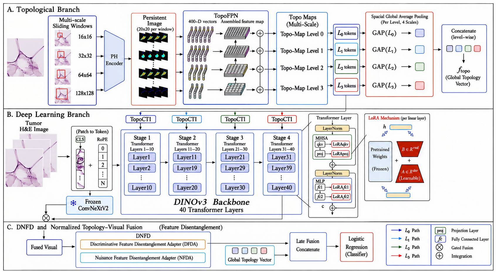

# TopoFormer

**A Multi-Scale Topology-Aware Vision Transformer for H&E Tumor Classification**

TopoFormer integrates a pretrained DINOv3 ViT-7B/16 visual foundation model with persistent-homology (PH) representations for patch-level histopathological classification. Its architecture combines a **multi-scale topology feature pyramid (TopoFPN)**, **topology-conditioned token interaction (TopoCTI)**, **ConvNeXtV2-based gated fusion**, a **discriminative–nuisance feature disentanglement (DNFD)** module, and a **global topological vector** for the final classifier.



## Datasets

| Dataset | Source | Task |
|---|---|---|
| DeepHisto | [Zenodo v0.1](https://doi.org/10.5281/zenodo.7941080) | Five-class brain histopathology classification |
| NCT-CRC-HE-100K | [Zenodo v0.1](https://doi.org/10.5281/zenodo.1214456) | Nine-class colorectal tissue training set |
| CRC-VAL-HE-7K | [Zenodo v0.1](https://doi.org/10.5281/zenodo.1214456) | Independent CRC test set (7,180 patches) |
| TCGA-UT | [Zenodo](https://doi.org/10.5281/zenodo.5889558) · [Hugging Face](https://huggingface.co/datasets/dakomura/tcga-ut) | External three-class glioma evaluation |

### Data partitions

- **DeepHisto:** The official patient-wise training/test partition is preserved; the held-out test set contains **4,174 patches**.
- **CRC:** NCT-CRC-HE-100K supplies the training/development data; CRC-VAL-HE-7K is used as the independent final test set.
- **Internal validation:** A stratified 10% of each official training set is reserved for validation; the other 90% is used for training. Checkpoints are selected using validation balanced accuracy. Official test sets are not used for checkpoint selection.
- **Run seeds:** DeepHisto **42, 123, 666**; CRC **12, 42, 666**.

### TCGA-UT external evaluation

The external evaluation comprises **786 patches**, drawn from the three subtype directories listed below. **Separate three-class DeepHisto models** were trained on astrocytoma, glioblastoma, and oligodendroglioma; normal and necrosis were excluded during training. The experiment does not select three outputs from a five-class classifier.

| External directory | Three-class label | Patches | Distinct WSI identifiers |
|---|---|---:|---:|
| `astrocytoma/` | `astro` | 282 | 69 |
| `glioblastoma/` | `gbm` | 344 | 79 |
| `oligodendroglioma/` | `oligo` | 160 | 39 |
| **Total** | | **786** | **187** |

The cohort is tracked in **`TCGA_UT_786_sample_manifest.csv`**, with fields `Dataset`, `OriginalFolder`, `MappedLabel5to3`, `WSI_ID`, and `PatchPath`. `WSI_ID` identifies a source slide directory; the total of 187 distinct WSI identifiers is **not** a count of independently verified patients. Original source imagery can be obtained from [TCGA-UT](https://huggingface.co/datasets/dakomura/tcga-ut/tree/main/data). When sharing the manifest, update `PatchPath` entries as necessary for the local dataset location.

External images are evaluated both **with and without Reinhard-style color normalization**. Reference BGR-channel mean and standard-deviation statistics are estimated from **3,000 sampled DeepHisto training patches** and applied only at external evaluation. Model checkpoints remain fixed across the two conditions.

## Environment

The experiments reported in the manuscript use **PyTorch 2.6.0**, **CUDA 12.4**, **GUDHI 3.10.0**, and an **NVIDIA A40 (48 GB)** GPU.

```bash
conda create -n topoformer python=3.10 -y
conda activate topoformer
# Install the CUDA-compatible PyTorch build matching the system.
pip install -r requirements.txt
python -c "import torch, gudhi; print(torch.__version__, torch.version.cuda, gudhi.__version__)"
```

### Pretrained weights

Configure the local paths to the official pretrained checkpoints in the corresponding training scripts:

- **DINOv3 ViT-7B/16:** [official DINOv3 repository](https://github.com/facebookresearch/dinov3); checkpoint filename `dinov3_vit7b16_pretrain_lvd1689m-a955f4ea.pth`.
- **ConvNeXtV2-Base:** [official ConvNeXt-V2 repository](https://github.com/facebookresearch/ConvNeXt-V2); checkpoint filename `convnextv2_base_1k_224_ema.pt`.

Pretrained weights are subject to their original distribution and license conditions.

## Persistent-homology preprocessing

The **visual branch** uses **224 × 224 RGB** inputs with ImageNet normalization. The **PH branch** uses separately resized grayscale images:

| Configuration | DeepHisto | CRC |
|---|---:|---:|
| PH grayscale input | **128 × 128** | **224 × 224** |
| Foreground threshold (8-bit grayscale) | **200** | **180** |
| Morphological dilation | 2 × 2 kernel, one iteration | Same |
| Local PH windows | 16, 32, 64, 128 pixels | Same |
| Stride | Equal to each window size | Same |
| Complex and homology | Alpha complex, **H1** | Same |
| Persistence image | 20 × 20, Gaussian bandwidth 1.0, uniform weighting | Same |
| TopoFPN feature alignment | Nearest-neighbor top-down upsampling | Same |

OpenCV grayscale conversion and area interpolation are used before PH construction. Pixels with intensities **above** the foreground threshold are set to zero; retained grayscale intensities are preserved. A single morphological dilation is then applied, and the spatial coordinates of nonzero pixels in each local window form the alpha-complex point set.

Topology maps for the four levels are generated by the dataset-specific preprocessing modules:

```text
notebooks/TopoFPN_layer.py
notebooks/TopoFPN_vector.py
notebooks/TopoFPN_layer_CRC_180.py
notebooks/TopoFPN_vector_CRC_180.py
```

The training pipeline loads the resulting aligned per-level `.npz` maps. The image files, dataset splits, and cached topology entries must be matched by their sample identifiers.

## Architecture and training

| Component | Configuration |
|---|---|
| Visual backbone | DINOv3 ViT-7B/16, pretrained weights frozen |
| DINOv3 adaptation | LoRA rank 16, alpha 16, dropout 0.05 |
| TopoCTI stages | Blocks 1–10, 11–20, 21–30, 31–40 |
| Injection locations | Before blocks 1, 11, 21, and 31 |
| TopoCTI attention | Visual patch tokens query topology tokens; 64 heads |
| Attention / projection dropout | 0.1 / 0.1 |
| Topology update clipping | 0.3 × patch-token norm |
| ConvNeXtV2 branch | Pretrained and frozen, gated visual fusion |
| DNFD objective weights | λortho = 0.05; λadv = 0.1 |
| Optimizer | AdamW, initial LR 5 × 10⁻⁵, weight decay 0.05 |
| Training | Two epochs; initial batch size 8; FP16 mixed precision |
| Additional settings | Gradient clipping 1.0, label smoothing 0.05, EMA 0.999, class-balanced sampling with replacement |
| Checkpoint selection | Best validation balanced accuracy |
| Final classifier | Independent normalization of discriminative and topological features; L2-regularized logistic regression (C = 1.0) |

DNFD is designed to **encourage task-related feature differentiation** using a discriminative feature branch, an auxiliary branch, and regularization objectives. The experiments support partial class-related representation differentiation; they do not establish complete stain/background nuisance removal.

### Example training entry points

Prepare the official datasets, configure pretrained checkpoint paths and the aligned topology caches, then run the dataset-specific script:

```bash
# DeepHisto: threshold 200, seed 42
python scripts/train_briancancer_rgb_200_seed42.py

# CRC: threshold 180, seed 42
python scripts/train_crc_rgb_180_seed42.py
```

These commands use the paths configured inside the scripts. The other reported seeds follow the same experimental settings and use the corresponding seed-specific training/checkpoint configurations.

### Final feature-fusion evaluation

The seed-specific evaluation notebooks are organized as follows:

| Dataset | Seed | Notebook |
|---|---:|---|
| DeepHisto | 42 | `Final_feature_fusion_eval_briancancer—200_seed42.ipynb` |
| DeepHisto | 123 | `Final_feature_fusion_eval_briancancer—200_seed123.ipynb` |
| DeepHisto | 666 | `Final_feature_fusion_eval_briancancer—200_seed666.ipynb` |
| CRC | 12 | `Final_feature_fusion_eval_crc—180_seed12.ipynb` |
| CRC | 42 | `Final_feature_fusion_eval_crc—180_seed42.ipynb` |
| CRC | 666 | `Final_feature_fusion_eval_crc—180_seed666.ipynb` |

Open each notebook in Jupyter with the matching model checkpoint, feature cache, and test-set paths.

## Reported benchmark results

The following are three-run mean ± sample standard deviation (%):

| Dataset | Accuracy | Balanced accuracy | Macro precision | Macro-F1 | Macro OvR-AUC |
|---|---:|---:|---:|---:|---:|
| DeepHisto | 97.42 ± 0.16 | 90.60 ± 1.10 | 95.84 ± 0.46 | 92.70 ± 0.87 | 99.63 ± 0.12 |
| CRC | 96.98 ± 0.23 | 95.56 ± 0.36 | 95.63 ± 0.28 | 95.53 ± 0.33 | 99.76 ± 0.09 |

Additional analyses in the manuscript and supplementary material include component ablations, controlled stain/spatial perturbations, feature discriminability, foreground-threshold sensitivity, runtime profiling, and paired statistical comparisons.

## Computational considerations

The reported TopoFormer configuration contains approximately **7.12B total parameters** and **321.6M trainable parameters**. The pretrained backbone is frozen and adapted with LoRA, but full-model inference still incurs the computational cost of the large backbone. PH maps may be precomputed and cached for repeated evaluation; online PH extraction introduces additional preprocessing latency. The reported results describe **patch-level classification**, not a validated whole-slide clinical deployment pipeline.

## Citation and licensing

If you use this work, please cite the associated TopoFormer manuscript. Project source code, third-party libraries, pretrained model weights, and datasets remain subject to their applicable licenses; see the repository's `LICENSE` and the original upstream distributions.
