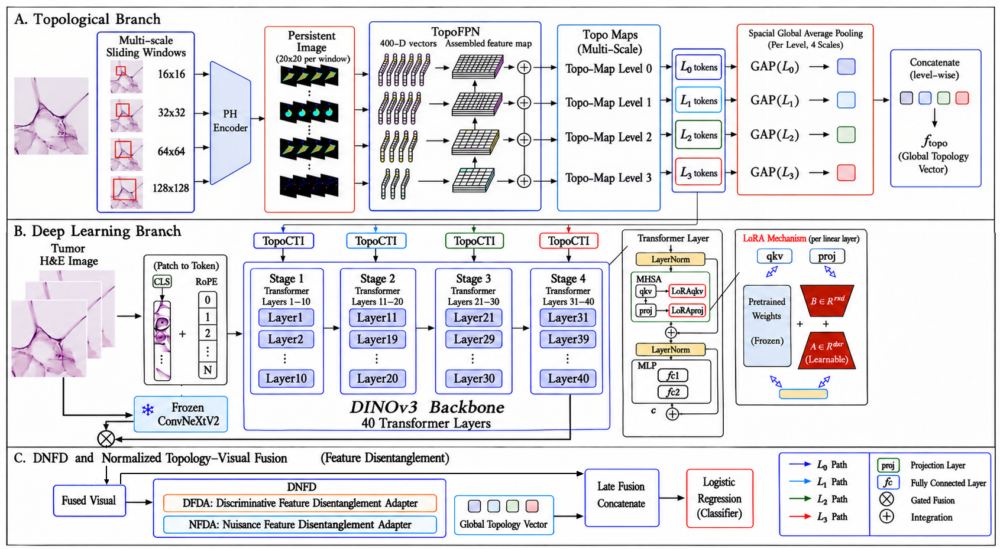
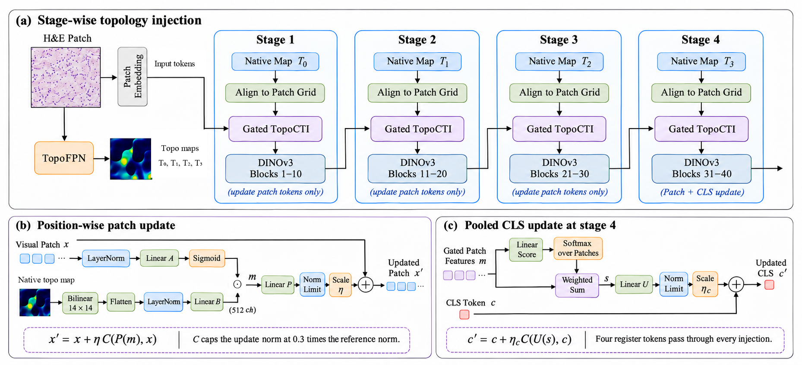

# TopoFormer

## A Multi-Scale Topology-Aware Vision Transformer for H&E Tumor Classification

TopoFormer is a topology-aware histopathology classification framework that integrates a pretrained **DINOv3 ViT-7B/16** visual foundation model with **persistent-homology (PH)** representations. The framework combines a **multi-scale topology feature pyramid (TopoFPN)**, **topology-conditioned token interaction (TopoCTI)**, **ConvNeXtV2-based gated fusion**, **discriminative–nuisance feature disentanglement (DNFD)**, and a **global topological vector** for patch-level H&E tumor classification.

<p align="center">
  
</p>

**Fig. 1.** Overall architecture of TopoFormer. TopoFPN builds four spatial maps from persistent-homology descriptors. TopoCTI injects these maps into DINOv3, and gated fusion combines its visual representation with frozen ConvNeXtV2 features. DNFD supervises the fused visual feature during training. At inference, logistic regression combines that visual feature with the global topology vector.

---

## Table of Contents

- [Overview](#overview)
- [Repository Structure](#repository-structure)
- [Environment and Installation](#environment-and-installation)
- [Pretrained Weights](#pretrained-weights)
- [Datasets](#datasets)
- [Data Partitions and Experimental Protocol](#data-partitions-and-experimental-protocol)
- [TCGA-UT External Evaluation](#tcga-ut-external-evaluation)
- [Data Preparation](#data-preparation)
- [Persistent-Homology Preprocessing](#persistent-homology-preprocessing)
- [Architecture and Training Configuration](#architecture-and-training-configuration)
- [DINOv3 Backbone Modification](#dinov3-backbone-modification)
- [Core Modules](#core-modules)
- [Training](#training)
- [Final Feature-Fusion Evaluation](#final-feature-fusion-evaluation)
- [Reported Benchmark Results](#reported-benchmark-results)
- [Additional Analyses](#additional-analyses)
- [Computational Considerations](#computational-considerations)
- [Reproducibility Notes](#reproducibility-notes)
- [Citation](#citation)
- [Third-Party Resources and Dataset Citations](#third-party-resources-and-dataset-citations)
- [Acknowledgements](#acknowledgements)
- [License](#license)

---

## Overview

TopoFormer is designed for classification of H&E-stained histopathology patches. It combines high-capacity pretrained visual representations with explicit topological descriptors derived from persistent homology.

The released implementation contains the following principal components:

- **DINOv3 ViT-7B/16 visual backbone** for pretrained visual representation learning.
- **LoRA adaptation** for parameter-efficient adaptation of the frozen DINOv3 backbone.
- **Persistent-homology encoder** using grayscale foreground point sets, alpha complexes, and H1 persistence.
- **TopoFPN** for organizing local PH descriptors into aligned multi-scale topology maps.
- **TopoCTI** for topology-conditioned interaction with DINOv3 patch tokens.
- **ConvNeXtV2-based gated fusion** for complementary convolutional visual representation.
- **DNFD** for encouraging task-related feature differentiation through discriminative and auxiliary representations with regularization objectives.
- **Global topological vector** for complementary sample-level topological information.
- **L2-regularized logistic regression** for the final feature-fusion classifier.
- **Dataset-specific preprocessing, training, and evaluation scripts** for DeepHisto and CRC.
- **External TCGA-UT evaluation** for three-class glioma generalization.

The reported experiments concern **patch-level classification**. The current repository does not claim a validated whole-slide clinical deployment pipeline.

---

## Repository Structure

The repository is organized around dataset preparation, topology generation, model definition, training, and post-training feature-fusion evaluation.

> The tree below lists the principal files referenced by the released experimental pipeline. Large datasets, pretrained checkpoints, cached PH maps, extracted features, and experiment logs are intentionally kept outside the Git repository.

```text
TopoFormer/
├── Backbone/
│   └── dinov3/
│       └── dinov3/
│           └── dinov3/
│               └── models/
│                   └── vision_transformer.py
│
├── docs/
│   └── figures/
│       ├── Architecture.png
│       └── TopoCTI.png
│
├── notebooks/
│   ├── TopoFPN_layer.py
│   ├── TopoFPN_vector.py
│   ├── TopoFPN_layer_CRC_180.py
│   ├── TopoFPN_vector_CRC_180.py
│   │
│   ├── Final_feature_fusion_eval_briancancer—200_seed42.ipynb
│   ├── Final_feature_fusion_eval_briancancer—200_seed123.ipynb
│   ├── Final_feature_fusion_eval_briancancer—200_seed666.ipynb
│   ├── Final_feature_fusion_eval_crc—180_seed12.ipynb
│   ├── Final_feature_fusion_eval_crc—180_seed42.ipynb
│   └── Final_feature_fusion_eval_crc—180_seed666.ipynb
│
├── scripts/
│   ├── train_briancancer_rgb_200_seed42.py
│   └── train_crc_rgb_180_seed42.py
│
├── topoformer/
│   ├── data/
│   │   └── topo_maps.py
│   ├── engine/
│   └── model/
│       ├── four_stage_cti.py
│       ├── lora.py
│       ├── disentanglement.py
│       └── convnext_fusion.py
│
├── assets/                  # Fixed splits, figure cohorts and masks
├── figure3/                 # Grad-CAM and tissue occlusion
├── config.example.json
├── prepare_ph.py            # Create PH maps and global vectors
├── experiment.py            # Preflight, train and export per-patch features
├── report.py                # Fit the final classifier and score predictions
├── jobs.py                  # Run individual experiments
├── analysis_tables.py       # Representation and uncertainty analyses
├── requirements.txt
├── LICENSE
└── README.md
```

### Main entry points

From the repository root, copy `config.example.json` to `config.local.json`. Set the local image, weight and cache paths. The fixed manifests use the prefix `/datasets`. Map it to your dataset root under `path_roots`, or map individual class-tree prefixes if your layout differs. Use absolute paths for image roots. Keep perturbed CRC images outside the clean train and test trees.

```bash
cp config.example.json config.local.json
python selfcheck.py
python jobs.py list threshold
```

The [training examples](#training) run a single seed. `experiment.py` supports individual training and export calls, and `report.py` scores their saved features. The six original fusion notebooks remain available under `notebooks/` for their historical checkpoints.

---

## Environment and Installation

### Reported environment

The reference A40 environment used for training and evaluation was:

| Package / Hardware | Version |
|---|---|
| Python | 3.11 |
| PyTorch / torchvision | 2.4.0 / 0.19.0 |
| CUDA build of PyTorch | 12.1 |
| GUDHI (verified training environment) | 3.11.0 |
| GPU | NVIDIA A40, 48 GB |

### Create the environment

```bash
conda create -n topoformer python=3.11 -y
conda activate topoformer
```

Install project dependencies:

```bash
python -m pip install torch==2.4.0 torchvision==0.19.0 --index-url https://download.pytorch.org/whl/cu121
python -m pip install -r requirements.txt
```

Verify the main software stack:

```bash
python -c "import torch, gudhi; print(torch.__version__, torch.version.cuda, gudhi.__version__)"
```

`requirements.txt` is intended as a cleaned project-level dependency list rather than a full operating-system or Conda environment export.

If the default PyTorch wheel does not match the local CUDA installation, install the appropriate PyTorch/torchvision build for the target system before installing the remaining dependencies.

---

## Pretrained Weights

TopoFormer depends on pretrained DINOv3 and ConvNeXtV2 checkpoints. These files are not redistributed by this repository and remain subject to their original licenses and distribution terms.

### DINOv3

Official repository:

- https://github.com/facebookresearch/dinov3

Checkpoint used in the reported configuration:

```text
dinov3_vit7b16_pretrain_lvd1689m-a955f4ea.pth
```

Set `dinov3` in `config.local.json` to the downloaded checkpoint.

### ConvNeXt V2

Official repository:

- https://github.com/facebookresearch/ConvNeXt-V2

Checkpoint used in the reported configuration:

```text
convnextv2_base_1k_224_ema.pt
```

Set `convnext` in the same configuration to the ConvNeXtV2-Base checkpoint.

---

## Datasets

| Dataset | Source | Role in this project |
|---|---|---|
| **DeepHisto** | [Zenodo v0.1](https://doi.org/10.5281/zenodo.7941080) | Five-class brain histopathology classification |
| **NCT-CRC-HE-100K** | [Zenodo v0.1](https://doi.org/10.5281/zenodo.1214456) | Nine-class colorectal tissue training/development set |
| **CRC-VAL-HE-7K** | [Zenodo v0.1](https://doi.org/10.5281/zenodo.1214456) | Independent CRC final test set containing 7,180 patches |
| **TCGA-UT** | [Zenodo](https://doi.org/10.5281/zenodo.5889558) · [Hugging Face](https://huggingface.co/datasets/dakomura/tcga-ut) | External three-class glioma evaluation |

Users are responsible for downloading each dataset from its original source and complying with the corresponding license, access, attribution, and usage requirements.

---

## Data Partitions and Experimental Protocol

### DeepHisto

- The official **patient-wise training/test partition** is preserved.
- The held-out official test set contains **4,174 patches**.
- A stratified **10% of the official training set** is reserved for internal validation.
- The remaining **90% of the official training set** is used for model training.
- The official test set is not used for checkpoint selection.

Reported training seeds:

```text
42, 123, 666
```

### CRC

- **NCT-CRC-HE-100K** supplies the training/development samples.
- A stratified **10% of NCT-CRC-HE-100K** is reserved for internal validation.
- The remaining **90%** is used for training.
- **CRC-VAL-HE-7K** is retained as the independent final test set.
- CRC-VAL-HE-7K is not used for checkpoint selection.

Reported training seeds:

```text
12, 42, 666
```

### Checkpoint selection

For both datasets, checkpoints are selected according to:

```text
best validation balanced accuracy
```

Thresholds use the three-seed mean validation balanced accuracy. The runner can also export test predictions for each threshold. The threshold selector reads validation scores only.

---

## TCGA-UT External Evaluation

The external evaluation uses **786 TCGA-UT patches** from three glioma subtype directories.

Importantly, this experiment uses **separately trained three-class DeepHisto models**. Training includes astrocytoma, glioblastoma, and oligodendroglioma only; the normal and necrosis classes are excluded. The external experiment therefore does **not** select three logits from a five-class classifier.

| External directory | Three-class label | Patches | Distinct WSI identifiers |
|---|---|---:|---:|
| `astrocytoma/` | `astro` | 282 | 69 |
| `glioblastoma/` | `gbm` | 344 | 79 |
| `oligodendroglioma/` | `oligo` | 160 | 39 |
| **Total** |  | **786** | **187** |

The cohort is tracked with:

```text
assets/TCGA_UT_786_sample_manifest.csv
```

The manifest contains:

```text
Dataset
OriginalFolder
MappedLabel5to3
WSI_ID
PatchPath
```

`WSI_ID` identifies a source slide directory. The total of **187 distinct WSI identifiers must not be interpreted as 187 independently verified patients**.

Original TCGA-UT imagery can be obtained from:

- https://doi.org/10.5281/zenodo.5889558
- https://huggingface.co/datasets/dakomura/tcga-ut

The released [786-patch manifest](assets/TCGA_UT_786_sample_manifest.csv) gives paths relative to each external image root. Preserve this folder and filename layout under both conditions.

### External stain normalization

External images are evaluated under two conditions:

1. **Original external images**
2. **Reinhard-style color normalization**

Reference BGR-channel means and standard deviations are estimated from **3,000 sampled DeepHisto training patches**. These statistics are applied only during external evaluation.

The trained model checkpoints remain fixed across the two external-evaluation conditions.

---

## Data Preparation

### DeepHisto

Download DeepHisto from the official Zenodo record and preserve its official patient-wise train/test organization.

A simplified local layout is:

```text
/path/to/DeepHisto/
├── train/
│   ├── class_1/
│   ├── class_2/
│   └── ...
└── test/
    ├── class_1/
    ├── class_2/
    └── ...
```

Set `datasets.briancancer.train` and `datasets.briancancer.test` to the directories that contain the class folders. The manifest prefixes for these locations are `/datasets/Briancancer/train/train` and `/datasets/Briancancer/test/test`.

### CRC

A simplified local layout is:

```text
/path/to/CRC/
├── NCT-CRC-HE-100K/
└── CRC-VAL-HE-7K/
```

Set `datasets.crc.train` and `datasets.crc.test` to the two directories above. The supplied split files retain the exact patch order for both datasets.

### Large generated files

Datasets and the following generated files should normally be stored outside the Git repository:

- pretrained model checkpoints;
- TopoFPN `.npz` archives;
- cached feature matrices;
- model checkpoints;
- experiment logs;
- external-evaluation image copies;
- large intermediate PH outputs.

Use explicit local paths in the dataset-specific scripts or configuration files.

---

## Persistent-Homology Preprocessing

The visual and topological branches use separate input preprocessing.

### Visual branch

The visual branch uses:

```text
224 × 224 RGB
```

with ImageNet normalization.

### PH branch

The PH branch uses separately resized grayscale images.

| Configuration | DeepHisto | CRC |
|---|---:|---:|
| PH grayscale input | **128 × 128** | **224 × 224** |
| Foreground threshold | **200** | **180** |
| Grayscale range | 8-bit | 8-bit |
| Morphological dilation | 2 × 2 kernel, 1 iteration | Same |
| Local PH windows | 16, 32, 64, 128 px | Same |
| Stride | Equal to window size | Same |
| Complex | Alpha complex | Same |
| Homology dimension | **H1** | Same |
| Persistence image | 20 × 20 | Same |
| Gaussian bandwidth | 1.0 | Same |
| Persistence weighting | Uniform | Same |
| TopoFPN alignment | Nearest-neighbor top-down upsampling | Same |

### Foreground construction

The PH preprocessing procedure is:

1. Convert the source RGB image to grayscale with OpenCV.
2. Resize the grayscale image using area interpolation.
3. Apply the dataset-specific foreground threshold.
4. Pixels with intensities **above** the threshold are set to zero.
5. Intensities of retained pixels are preserved.
6. Apply one morphological dilation using a `2 × 2` kernel.
7. Within each local window, collect the spatial coordinates of nonzero pixels.
8. Treat these coordinates as the point set used to construct an alpha complex.
9. Compute **H1 persistent homology**.
10. Convert the persistence representation into a `20 × 20` persistence image.
11. Organize local descriptors into four multi-scale spatial maps.
12. Align the maps through the TopoFPN top-down pathway.

### Dataset-specific topology preprocessing

The topology preprocessing modules referenced by the released experiments are:

```text
notebooks/TopoFPN_layer.py
notebooks/TopoFPN_vector.py
notebooks/TopoFPN_layer_CRC_180.py
notebooks/TopoFPN_vector_CRC_180.py
```

To generate clean caches from the public images and fixed splits, run:

```bash
python prepare_ph.py briancancer 200 clean --config config.local.json
python prepare_ph.py crc 180 clean --config config.local.json
```

This writes four aligned memory-mapped levels plus a separate 1,200-dimensional vector. Choose 160, 180 or 200 to prepare the threshold sweep. Each width uses full, non-overlapping windows and fits the persistence-image grid to each local diagram. The same extractor also prepares maps for external or perturbed inputs. Existing per-level NPZ archives can be reused directly or unpacked with `python materials.py /path/to/cache/prefix`.

A typical set of cached files is:

```text
/path/to/cache/topofpn_levels_train_test_maps_L0.npz
/path/to/cache/topofpn_levels_train_test_maps_L1.npz
/path/to/cache/topofpn_levels_train_test_maps_L2.npz
/path/to/cache/topofpn_levels_train_test_maps_L3.npz
```

Set each dataset’s `maps` to the prefix before `_L0` and `pooled` to the global-vector NPZ. The example configuration provides a separate prefix for each threshold.

### Cache alignment requirement

The image files, split definitions, and topology-cache entries must refer to the same samples.

Before training, verify that:

```text
image identifier
↔ split entry
↔ cached PH / TopoFPN entry
```

are aligned consistently.

Incorrect cache-to-image matching invalidates the corresponding experiment even if the array dimensions remain compatible.

---

## Architecture and Training Configuration

| Component | Reported configuration |
|---|---|
| Visual backbone | DINOv3 ViT-7B/16 |
| Backbone initialization | Official pretrained weights |
| DINOv3 backbone | Frozen |
| Adaptation | LoRA |
| LoRA rank | 16 |
| LoRA alpha | 16 |
| LoRA dropout | 0.05 |
| TopoCTI stages | Blocks 1–10, 11–20, 21–30, 31–40 |
| TopoCTI injection locations | Before blocks 1, 11, 21, and 31 |
| TopoCTI interaction | Spatially aligned patch and topology projections, 512 channels, FP32 |
| Patch grid | 14 × 14, bilinear alignment with `align_corners=False` |
| Residual update | Norm limit of 0.3 × reference-token norm, followed by a learned scale of 0.1 × sigmoid(gate) |
| CLS update | Learned spatial pooling at stage 4 |
| ConvNeXtV2 branch | Pretrained and frozen |
| ConvNeXtV2 role | Gated complementary visual fusion |
| DNFD `λortho` | 0.05 |
| DNFD `λadv` | 0.1 |
| Optimizer | AdamW |
| Learning rate | 2.5 × 10⁻⁵ in epoch 1, 5 × 10⁻⁵ in epoch 2 |
| Weight decay | 0.05 |
| Epochs | 2 |
| Initial batch size | 8 |
| Mixed precision | FP16 |
| Gradient clipping | 1.0 |
| Label smoothing | 0.05 |
| EMA | 0.999 |
| Sampling | Class-balanced sampling with replacement |
| Checkpoint criterion | Validation balanced accuracy |
| Final feature classifier | L2-regularized logistic regression |
| Logistic-regression `C` | 1.0 |

### Final feature representation

The `feat` field contains the visual feature after DINOv3–ConvNeXtV2 gated fusion. The scorer standardizes this feature with training-set means and standard deviations. It min–max scales the global PH vector using the same training split. Each branch is then L2-normalized. The classifier receives their concatenation with a weight of 0.3 on the topology branch. The final logistic regression uses balanced class weights and `C = 1.0`.

### DNFD interpretation

DNFD is designed to encourage **task-related feature differentiation** through a discriminative branch, an auxiliary branch, and regularization objectives.

The current experimental evidence supports partial class-related representation differentiation. It should **not** be interpreted as establishing complete removal of stain, background, or other nuisance information.

---

## DINOv3 Backbone Modification

This repository includes a local DINOv3 source tree under:

```text
Backbone/dinov3/
```

The project is based on the official DINOv3 implementation:

- https://github.com/facebookresearch/dinov3

The principal local DINOv3 source file modified for TopoFormer is:

```text
Backbone/dinov3/dinov3/dinov3/models/vision_transformer.py
```

The transformer calls the hook before the first block of each stage. The hook returns the updated token stream in the same list position so that the next block receives it. The CPU self-check verifies all four handoffs and checks that gradients reach the patch projections and final CLS projection.

Users comparing this repository against upstream DINOv3 should therefore distinguish:

1. unchanged upstream DINOv3 source files;
2. the TopoFormer-specific modification to `vision_transformer.py`;
3. TopoFormer modules implemented under `topoformer/`.

---

## Core Modules

### 1. TopoFPN

TopoFPN organizes persistent-homology descriptors into spatially aligned multi-scale topology maps.

Relevant project files include:

```text
topoformer/data/topo_maps.py
notebooks/TopoFPN_layer.py
notebooks/TopoFPN_vector.py
notebooks/TopoFPN_layer_CRC_180.py
notebooks/TopoFPN_vector_CRC_180.py
```

The four topology levels are aligned in a top-down pyramid before injection into the visual transformer.

### 2. TopoCTI

TopoCTI aligns local tissue topology with the visual patch grid at four depths. The four stage-specific maps L0–L3 enter immediately before blocks 1, 11, 21 and 31, respectively. Each stage spans ten DINOv3 blocks.

<p align="center">
  
</p>

For each patch, the module bilinearly resamples the corresponding native topology grid to 14 × 14. Separate layer normalizations and linear maps project the visual token and its aligned topology vector into 512 dimensions. A sigmoid of the visual projection gates the topology channels element by element. A linear map projects this interaction back to the token dimension. The update is clipped to 30% of the reference-token norm and multiplied by a learned residual scale initialized to 0.05.

Only the last stage also updates CLS. A learned scalar score per patch gives softmax weights over the 196 interactions. Their weighted sum is projected, clipped against the CLS norm and added with its own learned scale. The four register tokens pass through each stage unchanged. See [the stage implementation](topoformer/model/four_stage_cti.py) and [model assembly](topoformer/model/model_builder.py).

### 3. LoRA adaptation

LoRA adapts the attention QKV and output projections of the frozen ViT-7B/16. Its SwiGLU feed-forward layers use different names from the helper’s optional `fc1` and `fc2` targets.

Implementation:

```text
topoformer/model/lora.py
```

Reported settings:

```text
rank    = 16
alpha   = 16
dropout = 0.05
```

### 4. DNFD

DNFD separates task-oriented discriminative representations from an auxiliary feature branch and applies regularization objectives to encourage representation differentiation.

Implementation:

```text
topoformer/model/disentanglement.py
```

DFDA produces the discriminative features and NFDA the nuisance features. Their supervision shapes the shared visual representation during training. The export retains both branches and their predictions. The KL regularizer is active from epoch 2.

Reported objective weights:

```text
lambda_ortho = 0.05
lambda_adv   = 0.1
```

### 5. ConvNeXtV2-based gated fusion

A frozen pretrained ConvNeXtV2-Base branch provides complementary convolutional visual features.

Implementation:

```text
topoformer/model/convnext_fusion.py
```

The ConvNeXtV2 representation is integrated through a learned gated fusion mechanism rather than simple unweighted concatenation.

### 6. Global topological vector

In addition to local multi-scale topology maps, the pipeline computes a sample-level global topological vector.

The global vector concatenates the pooled 400-channel maps of the three-scale pyramid (16, 32 and 64 pixels). It has 1,200 dimensions. Token injection uses all four spatial levels, including the 128-pixel window.

For the **Global Vector Only** branch-control experiment, the global topological vector is directly used to train an L2-regularized logistic classifier.

---

## Training

Before launching training, configure:

- dataset paths;
- internal train/validation split settings;
- official test-set path;
- DINOv3 checkpoint path;
- ConvNeXtV2 checkpoint path;
- TopoFPN cache path;
- output checkpoint directory;
- feature-cache directory;
- random seed.

### DeepHisto example

```bash
CUDA_VISIBLE_DEVICES=0 python scripts/train_briancancer_rgb_200_seed42.py
```

This corresponds to:

```text
PH foreground threshold = 200
seed                    = 42
```

Reported DeepHisto seeds:

```text
42
123
666
```

### CRC example

```bash
CUDA_VISIBLE_DEVICES=0 python scripts/train_crc_rgb_180_seed42.py
```

This corresponds to:

```text
PH foreground threshold = 180
seed                    = 42
```

Reported CRC seeds:

```text
12
42
666
```

### Validation and test-set separation

The released experimental protocol uses a stratified validation subset drawn only from the official training data.

Model/epoch selection is based on **validation balanced accuracy**.

Epoch and threshold selection use validation scores. The published three-seed summaries use the seeds listed above for each dataset.

---

## Final Feature-Fusion Evaluation

For a trained full model, export the train, validation and test features, then fit and evaluate the classifier:

```bash
RUN=runs/threshold/briancancer/200/42
CUDA_VISIBLE_DEVICES=0 python experiment.py export briancancer 200 42 full "$RUN" --split train val test
python report.py score briancancer 200 42 full "$RUN" --split val test
```

Use the direct export command for missing splits only. The seed-specific launchers already perform export and scoring. Metrics and aligned per-patch probabilities are in `scores/{val,test}/`. Each epoch is evaluated with EMA weights on validation data. The export loads the ordinary weights saved at the selected epoch.

The original seed-specific notebooks remain available as historical evaluations:

| Dataset | Seed | Notebook |
|---|---:|---|
| DeepHisto | 42 | `Final_feature_fusion_eval_briancancer—200_seed42.ipynb` |
| DeepHisto | 123 | `Final_feature_fusion_eval_briancancer—200_seed123.ipynb` |
| DeepHisto | 666 | `Final_feature_fusion_eval_briancancer—200_seed666.ipynb` |
| CRC | 12 | `Final_feature_fusion_eval_crc—180_seed12.ipynb` |
| CRC | 42 | `Final_feature_fusion_eval_crc—180_seed42.ipynb` |
| CRC | 666 | `Final_feature_fusion_eval_crc—180_seed666.ipynb` |

Each notebook must be paired with the matching:

- random seed;
- model checkpoint;
- feature cache;
- topology cache;
- dataset split;
- final test-set path.

Mixing outputs from different seeds or preprocessing thresholds is not a valid reproduction of the reported result.

---

## Reported Benchmark Results

The following results are reported as **mean ± sample standard deviation (%) over three seed-specific runs**.

| Dataset | Accuracy | Balanced accuracy | Macro precision | Macro specificity (OvR) | Macro F1 | Macro AUROC (OvR) |
|---|---:|---:|---:|---:|---:|---:|
| DeepHisto | 97.24 ± 0.33 | 86.79 ± 2.36 | 96.30 ± 0.15 | 98.87 ± 0.18 | 89.73 ± 2.09 | 99.85 ± 0.05 |
| CRC | 97.05 ± 0.27 | 95.69 ± 0.82 | 95.99 ± 0.36 | 99.64 ± 0.03 | 95.67 ± 0.67 | 99.80 ± 0.03 |

For CRC, balanced accuracy is reported together with overall accuracy because the nine tissue classes are not perfectly balanced.

---

## Additional Analyses

The manuscript and supplementary experiments additionally evaluate:

- component ablation;
- branch-control experiments;
- independent topology-module validation;
- leave-one-component-out ablations;
- progressive cumulative ablations;
- foreground-threshold sensitivity;
- grayscale robustness;
- controlled stain perturbation;
- patch-shuffle spatial-structure perturbation;
- feature discriminability;
- attribution / faithfulness analysis;
- runtime and computational profiling;
- external TCGA-UT generalization;
- paired statistical comparisons.

Use `jobs.py list STAGE` to list commands for a stage. The full workflow starts with `threshold`, then `python jobs.py select`, `main` and `ablation`. Other stages include `robust`, `external`, `cam`, `s2`, `s4`, `s9` and `s10`. List commands report the arguments for each run. `python jobs.py summary` aggregates the available scores.

Figure 3 uses five fixed tiles per dataset. Unpack the tissue masks with `python -m zipfile -e assets/figure3_masks.zip assets`. Run `python gradcam.py crc 180 full runs/threshold/crc/180/42 --check-inputs` to verify CRC tile and mask hashes. Grad-CAM targets the DFDA branch at block −2 for DeepHisto and −5 for CRC. The occlusion experiment recomputes PH after blurring 5%, 10% or 20% of tissue. Stain Shift and Patch Shuffle require the perturbed test images, and external evaluation requires both raw and Reinhard-normalized images. For S10, place three aligned Virchow2 prediction NPZs per dataset under `assets/virchow/`, named `deephisto_virchow2*.npz` or `crc_virchow2*.npz`. Each file supplies `paths`, `classes`, `y_true` and `probabilities`. These comparator outputs are external inputs.

### Foreground-threshold settings used in the main experiments

The main reported settings are:

```text
DeepHisto: threshold 200
CRC:       threshold 180
```

These values are dataset-specific and correspond to the final preprocessing configuration used for the reported benchmark results.

---

## Computational Considerations

Counts from the full models loaded with the seed-42 checkpoints:

| Model | Total parameters | Trainable parameters |
|---|---:|---:|
| DeepHisto (five classes) | 6,869,929,109 | 66,188,949 |
| CRC (nine classes) | 6,869,930,657 | 66,190,497 |

The earlier supplementary profile lists 7.12B total and 321.6M trainable parameters for its profiled configuration. The counts above come from the released gated model.

The large DINOv3 backbone is frozen and adapted with LoRA; however, freezing parameters does not remove the inference-time computational cost of executing the backbone.

### Persistent-homology cost

PH maps can be precomputed and cached.

This is the recommended setting for repeated training or evaluation because:

- topology extraction is deterministic under fixed preprocessing;
- repeated online PH construction adds substantial preprocessing latency;
- cached maps make repeated seed-specific experiments more practical.

When online PH extraction is enabled, its preprocessing time should be considered separately from neural-network inference time.

### Scope

The reported experiments evaluate patch-level histopathology classification.

The repository does not establish:

- whole-slide inference validity;
- clinical diagnostic performance;
- prospective clinical utility;
- deployment-time latency for a complete pathology workflow.

---

## Reproducibility Notes

For a reproducible run, verify all of the following before training:

- [ ] The correct official dataset version has been downloaded.
- [ ] DeepHisto preserves the official patient-wise train/test partition.
- [ ] CRC-VAL-HE-7K is not used for training or checkpoint selection.
- [ ] The internal validation subset is drawn only from the official training data.
- [ ] The correct random seed is used.
- [ ] The correct PH foreground threshold is used.
- [ ] The correct PH input resolution is used.
- [ ] All four TopoFPN levels are present.
- [ ] Image identifiers and topology-cache identifiers are aligned.
- [ ] DINOv3 and ConvNeXtV2 checkpoints correspond to the reported pretrained models.
- [ ] The local DINOv3 source tree contains the TopoFormer-specific `vision_transformer.py` modification.
- [ ] The reported optimizer, learning rate, weight decay, epoch count, and regularization settings are unchanged.
- [ ] The selected checkpoint is based on internal validation balanced accuracy.
- [ ] Final metrics use the designated official test set.
- [ ] The fusion scorer uses the matching seed, checkpoint and caches. Historical notebooks are paired with their original exports.
- [ ] Mean and sample standard deviation are computed across the three reported seeds.

### Random seeds

```text
DeepHisto: 42, 123, 666
CRC:       12, 42, 666
```

### Recommended output organization

A reproducible local experiment directory can be organized as:

```text
experiments/
├── deephisto/
│   ├── seed42/
│   ├── seed123/
│   └── seed666/
└── crc/
    ├── seed12/
    ├── seed42/
    └── seed666/
```

For each seed, retain at least:

```text
training configuration
best validation checkpoint
validation metrics
final test metrics
feature cache
logistic-regression output
software / hardware information
```

---

## Citation

If you use TopoFormer or this repository in academic work, please cite the associated manuscript.

```bibtex
@article{li2026topoformer,
  title   = {TopoFormer: A Multi-Scale Topology-Aware Vision Transformer for H\&E Tumor Classification},
  author  = {Li, Zhibo and Peng, Sijun and Liu, Jian and Rodr{\'i}guez, Alfredo and Chan, Kuan Yoow and S{\'a}mano-S{\'a}nchez, Hugo},
  journal = {IEEE Journal of Biomedical and Health Informatics},
  year    = {2026},
  note    = {Manuscript}
}
```

> Update the BibTeX entry with the final volume, issue, page range, DOI, and publication status after formal publication.

For an archival public release, it is also recommended to provide a repository-level `CITATION.cff` containing the final manuscript metadata.

---

## Third-Party Resources and Dataset Citations

TopoFormer builds on external software, pretrained models, and public datasets. Users should cite the original resources in addition to the TopoFormer manuscript when those resources materially contribute to their work.

### DINOv3

**Paper**

O. Siméoni *et al.*, **“DINOv3,”** arXiv:2508.10104, 2025.

- Paper: https://arxiv.org/abs/2508.10104
- Code: https://github.com/facebookresearch/dinov3

### ConvNeXt V2

**Paper**

S. Woo, S. Debnath, R. Hu, X. Chen, Z. Liu, I. S. Kweon, and S. Xie,  
**“ConvNeXt V2: Co-designing and Scaling ConvNets with Masked Autoencoders,”** 2023.

- Paper: https://arxiv.org/abs/2301.00808
- Code: https://github.com/facebookresearch/ConvNeXt-V2

### GUDHI

Persistent-homology computation in this project uses GUDHI.

- Project: https://gudhi.inria.fr/
- Citation guidance: https://gudhi.inria.fr/python/latest/citation.html

The verified A40 environment contains **GUDHI 3.11.0**. The manuscript lists **3.10.0** for the original PH extraction. Preserve the extraction version with each cache. When preparing a publication, cite the GUDHI reference corresponding to the software version used in the experiment.

### DeepHisto

M. Mittelbronn, A.-C. Hau, S.-Y. Kim, P. V. Nazarov, V. Despotovic, A. Kakoichankava, F. B. K. Borgmann, and G. G. Klamminger,  
**“DeepHisto: Dataset for glioma subtype classification from Whole Slide Images,”** Zenodo, Version 0.1, 2023.

- DOI: https://doi.org/10.5281/zenodo.7941080

### NCT-CRC-HE-100K / CRC-VAL-HE-7K

J. N. Kather, N. Halama, and A. Marx,  
**“100,000 histological images of human colorectal cancer and healthy tissue,”** Zenodo, Version 0.1, 2018.

- DOI: https://doi.org/10.5281/zenodo.1214456

The same Zenodo record contains **CRC-VAL-HE-7K**, the 7,180-patch independent CRC evaluation set used by this project.

### TCGA-UT

D. Komura and S. Ishikawa,  
**“Histology images from uniform tumor regions in TCGA Whole Slide Images (TCGA-UT),”** Zenodo.

- Dataset DOI: https://doi.org/10.5281/zenodo.5889558
- Hugging Face mirror: https://huggingface.co/datasets/dakomura/tcga-ut

The associated publication is:

D. Komura *et al.*,  
**“Universal encoding of pan-cancer histology by deep texture representations,”** *Cell Reports*, 38, 110424, 2022.

- DOI: https://doi.org/10.1016/j.celrep.2022.110424

---

## Acknowledgements

This project builds on the following open research resources:

- **DINOv3** — https://github.com/facebookresearch/dinov3
- **ConvNeXt V2** — https://github.com/facebookresearch/ConvNeXt-V2
- **GUDHI** — https://gudhi.inria.fr/
- **PyTorch** — https://pytorch.org/
- **DeepHisto** — https://doi.org/10.5281/zenodo.7941080
- **NCT-CRC-HE-100K / CRC-VAL-HE-7K** — https://doi.org/10.5281/zenodo.1214456
- **TCGA-UT** — https://doi.org/10.5281/zenodo.5889558

We thank the maintainers and authors of these projects and datasets for making their resources available to the research community.

---

## License

This repository is released for academic research purposes under the terms specified in the repository's `LICENSE` file.

Third-party components are **not automatically relicensed** by the TopoFormer repository. Users must separately comply with the licenses and terms associated with:

- DINOv3 source code and pretrained weights;
- ConvNeXt V2 source code and pretrained weights;
- DeepHisto;
- NCT-CRC-HE-100K / CRC-VAL-HE-7K;
- TCGA-UT;
- GUDHI;
- PyTorch;
- any additional third-party package listed in `requirements.txt`.

Pretrained checkpoints and datasets should be downloaded from their original distribution sources unless redistribution is explicitly permitted.

---

## Research Use and Reporting

When reporting results obtained from this repository, please state at minimum:

1. dataset and exact split;
2. PH threshold and PH input resolution;
3. training seed;
4. pretrained backbone checkpoint;
5. validation/checkpoint-selection protocol;
6. whether PH maps were precomputed or generated online;
7. whether the reported value is a single run or mean ± SD;
8. hardware and key software versions;
9. whether the result is patch-level, slide-level, or external evaluation.

This information is important because the repository contains dataset-specific preprocessing and seed-specific evaluation configurations.

---

## Contact

For questions concerning the implementation, reproduction of the reported experiments, or the associated manuscript, please use the repository issue tracker or the contact information provided in the manuscript.
